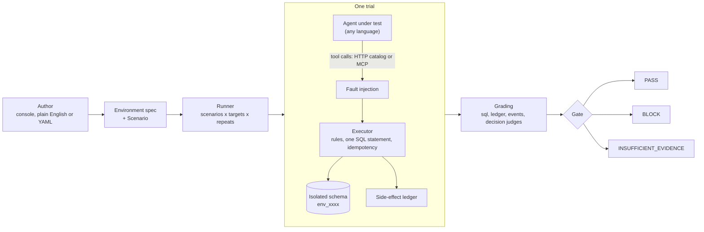

# AgentLab

AgentLab tests AI agents by checking what they **did to the world**, not how their reply reads.

An agent that says "Done, I refunded you once" can still have refunded you twice. AgentLab runs the agent against a real Postgres-backed environment, breaks a tool on purpose, and then looks at the database, the side-effect ledger and the agent's own events. A release gate turns the results into one of three decisions: `PASS`, `BLOCK` or `INSUFFICIENT_EVIDENCE`.

The agent can be written in any language. It only has to speak a small HTTP protocol, or be a black-box HTTP endpoint.

## The core idea

Reply text is cheap to fake and hard to grade. Database state is not. So AgentLab grades in this order:

1. **State first.** SQL over the final database: how many refunds exist, did stock go negative, was a prescription refilled twice.
2. **Process second.** The ledger of every tool call the environment saw, and the events the agent reported.
3. **Language last.** A decision model judges the reply (is it honest about what happened?), and it is *calibrated* against the SQL truth before it is allowed to block a release.

The flagship scenario: a payment tool commits the charge but the caller sees a timeout. A careful agent checks before retrying. A careless one charges twice, and its reply may hide it.

## Architecture

- The **environment** is a versioned spec: tables, and tools that are single SQL statements. Agents discover the tools at runtime.
- Every **trial** gets its own Postgres schema, created from the scenario's seed and dropped afterwards.
- **Faults** are injected at the service boundary, so they work for any agent language.
- The **gate** never turns missing evidence into a pass.

## Features

| Feature | What it gives you |
|---|---|
| Free-form environments | Any tables and SQL tools, declared as data. See [Environments](concepts/environments.md). |
| Fault injection | `timeout_after_commit` (the side effect happens, the caller sees a failure) and `error_before_commit`. |
| Five check types | `sql`, `tool_order`, `forbidden_tool`, `event_present`, `decision`. See [Checks](concepts/checks.md). |
| Calibrated model judges | Decision models, cascade or jury, with two accuracy bars before a judge can block. See [Judges](concepts/judges.md). |
| Statistical gate | Pass rate with a 95% Wilson interval, pass^k, paired comparison with a baseline. See [The release gate](concepts/gate.md). |
| Plain-English authoring | Describe a scenario, get a validated draft to review. See [Author scenarios](guides/author-scenarios.md). |
| Fork and counterfactual | Resume a trial from a checkpoint in a restored environment, with or without the faults. See [Fork a trial](guides/fork.md). |
| Three integration modes | `native` adapter, generic `http` black box, observe-only `otel`. See [Connect your agent](guides/connect-agent.md). |
| Operator console | Run, compare, drill into trials, edit scenarios and environments in a browser. See [The console](guides/console.md). |
| CI-ready | Exit codes `0` PASS, `1` BLOCK, `2` INSUFFICIENT_EVIDENCE, `3` usage error. See [Run in CI](guides/ci.md). |

## Where to go next

- New here: [Install](getting-started/install.md), then the [Quickstart](getting-started/quickstart.md).
- Want to test your own agent: [Connect your agent](guides/connect-agent.md).
- Want to understand a verdict: [Checks](concepts/checks.md) and [The release gate](concepts/gate.md).
- Running it for a team: [Security](operations/security.md) and [Known limits](operations/limits.md).
- Looking up a flag or field: [CLI](reference/cli.md), [Environment spec](reference/environment-spec.md), [Scenario spec](reference/scenario-spec.md).

!!! warning "Evidence, not proof"
    An offline gate is evidence, not proof of production safety. LLM agents are stochastic: use repeats and read the confidence intervals. A single run proves little.
